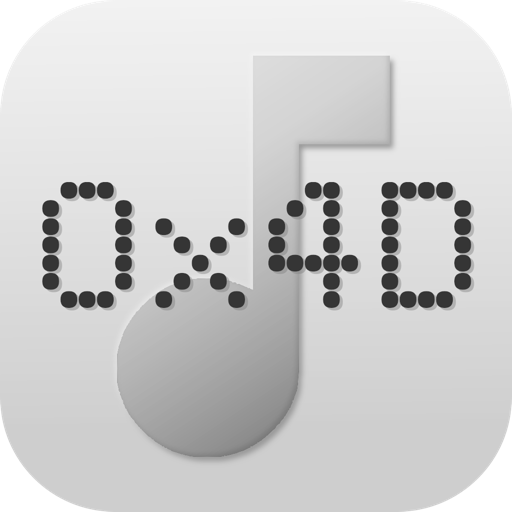
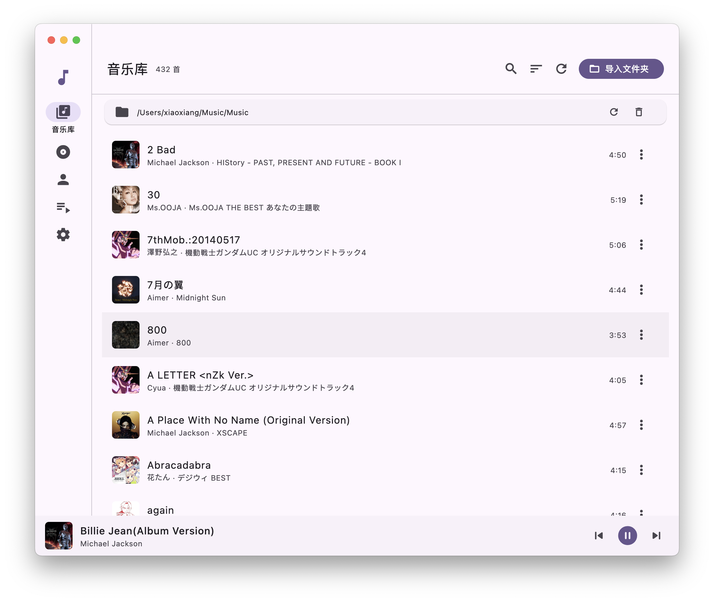
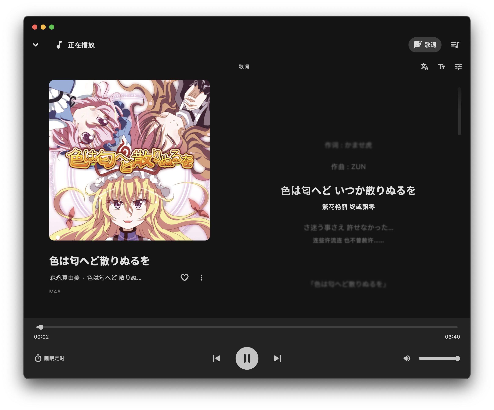

# 0x4D Music Player

**English** · [简体中文](README_zh.md)

A local music player built with **Flutter**.

<p align="center">
  
  <br/>
  
  <br/><br/>
  
  <br/>
  <sub>Now Playing — synced lyrics with per-character fill and line transitions</sub>
</p>

## Why 0x4D?

`0x4D` is how a hex editor writes 77 — the ASCII code of the letter **M**. The name is "Music"
spelled the way the tooling underneath spells it, and the icon is drawn the same way: the lettering
is set in a 9×9 dot-matrix font, one circle per pixel, with a flat eighth note running through the `4`.

## Features

- **Local music library** — pick a folder, scan your files, and parse embedded metadata (title, artist, album artist, album, track, disc, duration, year, genre, bitrate, sample rate, cover art). A file watcher keeps the library in sync when files change; removing a folder also cleans up orphaned albums and artists.
- **Albums & Artists** — browse by grid, open dedicated detail pages (album pages group tracks by disc), and hit "play all".
- **Playlists** — create / rename / delete playlists, add songs from the library, drag to reorder, import / export **M3U8**, plus a built-in **Favorites** view.
- **In-page search** — live filtering with match counts across Library, Albums, Artists and Playlists.
- **Playback queue** — play next, reorder, repeat modes and shuffle, with the queue, repeat/shuffle state and playback position persisted across restarts.
- **Hi-Res audio** — playback via `audioplayers`, including lossless formats like FLAC.
- **Lyrics** — synced LRC/QRC/YRC lyrics on the Now Playing page, auto-detected next to the audio file or read from embedded tags. Bilingual lines (e.g. Chinese-Japanese) are split into two timelines, and playback drives the highlight on every display frame.
- **Lyrics display** — a dedicated **Settings › Appearance › Lyrics display** page, also reachable from the player toolbar. On wide windows a live looped preview sits beside the controls, which cover text size and translation, per-character fill and Word Pop, line transitions, row-wave motion, distance blur and intro/interlude countdown dots. The preview and the player build the same preset, so what you see is what plays.
- **System media controls** (macOS) — lock-screen / media-key controls (play, pause, next, previous, seek) with Now Playing metadata and cover art; dock menu and window restore after close.
- **Localized UI** — English and Simplified Chinese, switchable in **Settings › General › Language** (follow system / English / 简体中文) with no restart.
- **Smart sorting** — pinyin and Japanese kana based sort keys for natural ordering in the library.
- **Cover art caching** — album art is extracted once and cached for fast browsing.
- **Volume & favorites** — persistent volume control and a favorites toggle on the player bar.
- **Logging & error handling** — leveled file logs with a built-in viewer, a startup error page, and graceful playback-error handling (auto-skip with a retry limit).

### Planned

- Gapless playback
- DSD support
- Windows / Linux support (maybe?)

The `android/`, `ios/` and `web/` folders were removed in 0.4.x: none of them was ever
more than template scaffolding. Regenerate one on demand with
`flutter create --platforms=<name> .` if that ever changes.

## Getting Started

### Prerequisites

- Flutter SDK (Dart `^3.12`) — see [flutter.dev](https://flutter.dev)
- macOS is currently the primary target (full media-control integration). Windows and
  Linux are planned; **iOS, Android and the web are out of scope** — the player assumes
  desktop file-system access (scanning arbitrary folders via security-scoped bookmarks)
  and a desktop layout.

### Build & Run

```bash
flutter pub get
flutter run -d macos
```

> Editing anything under `macos/` (Swift / native code) requires a native rebuild: quit the
> app, delete `build/macos`, then run again — hot reload and hot restart do not recompile
> Swift. **Do not run `flutter clean`** in this project: it hangs on the SQLite native
> assets built through Swift Package Manager.

### Localization

UI strings live in `lib/l10n/app_en.arb` (template) and `lib/l10n/app_zh.arb`.
After editing either file, regenerate the Dart classes:

```bash
flutter gen-l10n
```

The app language can be switched in **Settings › General › Language**
(follow system / English / Simplified Chinese) and is persisted in `settings.json`.
The generated `app_localizations*.dart` files are committed. See
[docs/I18n.md](docs/I18n.md) for conventions and known limits — notably, the macOS
native menu still follows the system language.

### macOS permissions

Music folders inside `~/Music` are protected by the **Media & Apple Music** privacy setting.
`NSOpenPanel` + security-scoped bookmarks only grant *Files and Folders* access, so a library
stored there still fails with `Operation not permitted` (errno 1) on the first scan.
Fix it once per machine:

1. Open **System Settings → Privacy & Security → Media & Apple Music**
2. Add `0x4D.app` with the `+` button and leave it enabled
3. Scan again — the library loads normally

## Project Structure

Feature-oriented layout — shared infrastructure in `core/`, business features in `features/`, reusable widgets in `widgets/`.

```
lib/
├── app/          # app configuration, routing, themes
├── core/         # audio, database, services, utils, constants
├── features/     # library, album, artist, playlist, player, settings, shell
├── models/       # application models
└── widgets/      # reusable UI components
```

See [docs/Architecture.md](docs/Architecture.md) for the full architecture and [docs/Rules.md](docs/Rules.md) for development conventions.

## Tech Stack

- **Flutter / Dart**
- **drift** — SQLite ORM for the local library database
- **audioplayers** — audio playback (single-track; queue logic lives in the app)
- **audio_metadata_reader** — metadata & embedded cover art parsing (pure Dart; uses the [cxx1234 fork](https://github.com/cxx1234/audio_metadata_reader) pinned to commit `4a6f245` for `albumArtist` + embedded lyrics support)
- **flutter_lyric** — LRC/QRC/YRC lyric rendering with word-level effects, line transitions and countdown dots
- **file_picker / watcher** — folder selection & library change watching
- **lpinyin** — pinyin sort keys

## Testing

```bash
flutter test
```

## Credits

- **App icon** — the `0x4D` lettering is set in
  [BoutiqueBitmap9x9 Circle Dot](https://fontspeech.blogspot.com/) (精品點陣體 9×9 圓形版) by
  字言字型 / fancy type foundry, and the artwork was composed in [Krita](https://krita.org/).
  The font file stays in `assets/fonts/` as the design source and is not bundled into the app.
  It is free software: unlimited permission to use, copy and distribute, with or without
  modification, commercially or otherwise; derivative works must carry the same licence, and the
  font name `BoutiqueBitmap` remains reserved.

## License

[MIT](LICENSE) © 2026 Jerry C
